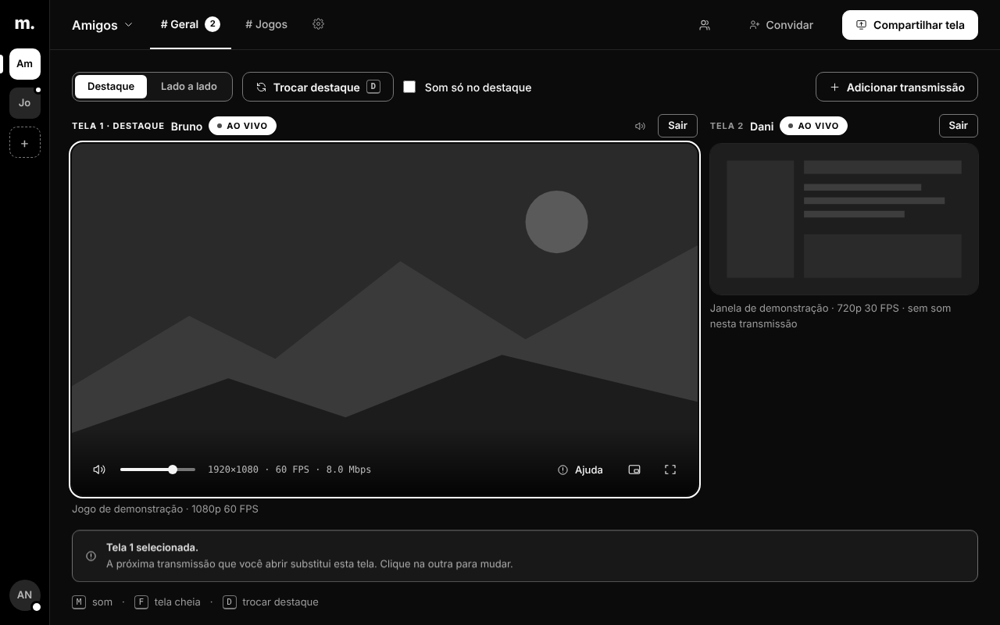

[Português](README.md)

<div align="center">

# madscreen

**Share an application's screen and audio with friends, with a focus on preserving game FPS.**

[](LICENSE)


[Download](https://github.com/vitoradriao/madscreen/releases/latest) ·
[Documentation](docs/README.md) ·
[Contribute](CONTRIBUTING.md) ·
[Roadmap](docs/roadmap.md)



</div>

> **English summary.** madscreen is an open-source (GPL-3.0-or-later) Windows app for sharing a window or
> monitor — plus that application's audio — with friends in private servers and channels. One install both
> streams and watches (up to two lives at once). Capture uses the official Windows APIs only (no DLL injection or
> game hooks); H.264 is encoded on the GPU (NVIDIA NVENC zero-copy, AMD AMF, Intel QuickSync) with an x264 CPU
> fallback, and delivered over WebRTC through a Cloudflare Realtime SFU, with a self-hosted LiveKit server as a
> backup. The goal is to protect the streamer's game FPS. The project is pre-1.0 and most documentation is in
> Brazilian Portuguese; see [docs/architecture.md](docs/architecture.md) and [docs/building.md](docs/building.md).

## What it is

madscreen is a Windows application that streams a **window or monitor** and the **audio of the selected
application** to friends in **private servers and channels** accessed by invitation. The same program handles
streaming and viewing: you can open **up to two live streams at once**, with independent volume, focus and
full screen. The project's priority is **preserving the streamer's game FPS**.

## Features

- **Official Windows capture:** Windows Graphics Capture (windows and Windows 11) and Desktop Duplication
  (monitor on Windows 10). No DLL injection or game hooks.
- **Per-application audio:** WASAPI *process loopback* at 48 kHz stereo with Opus. No microphone. PC audio excludes
  the app itself to avoid recapturing what you are watching.
- **Automatically selected H.264 encoders:** NVIDIA NVENC (D3D11 *zero-copy* path), AMD AMF, Intel QuickSync and
  CPU fallback (x264). No server-side transcoding.
- **Accounts and invitations:** Discord or Google login, username + invitation fallback with a recovery key,
  servers, channels, presence and access control.
- **Two live streams, one installation:** your own stream preview is always muted; shortcuts **D** (focus), **M**
  (sound) and **F** (full screen).
- **Network:** WebRTC through a Cloudflare SFU (primary) or self-hosted LiveKit (backup), with keyframe recovery
  and rate adaptation.
- **Signed updates:** the app checks the signature and version and installs only through a user action.
- **Web client** sharing the app's login, directory and playback modules.

## Project status

madscreen is in **pre-1.0 development** (the published version is 0.1.x). The interface and pipeline work
end to end, but **FPS, latency and A/V synchronization targets still require measurements across different
games and hardware** — building and passing tests is not the same as qualified performance. See
[docs/roadmap.md](docs/roadmap.md) for what has been measured, what is missing and what is under evaluation.

## Install and use

1. Download the `.exe` installer from the [latest release](https://github.com/vitoradriao/madscreen/releases/latest).
2. Open the invitation you received from a friend and sign in with Discord (username + invitation fallback is available).
3. Choose a channel. In **Compartilhar** (Share), select a window or monitor, quality and audio. To watch, open a
   live stream from the channel; add another to use two screens.

Minimizing or closing the window sends the app to the system tray; use the tray menu to quit or stop sharing.

**Requirements:** Windows 10 1903 x64 or later, with WGC and Direct3D 11. Streaming requires an NVIDIA, AMD or
Intel GPU with a hardware encoder (NVIDIA is not mandatory; a more costly CPU fallback is available).
Per-application audio depends on Windows support for *process loopback*; without it, video continues.
The app does not request microphone access.

> The app needs a **signaling server** (Cloudflare Worker) for accounts, channels and the SFU. Users of official
> releases do not need to configure anything; to run your own, see
> [docs/self-hosting.md](docs/self-hosting.md).

## How it works

```text
App Tauri 2 / WebView2
  ├─ UI compartilhada com o cliente web: login, convites, canais e dois players
  └─ supervisor ──► sidecar madscreen-encode-test --ipc (um processo por transmissão)
                      WGC / Desktop Duplication → D3D11 (escala + BGRA→NV12) → encoder automático
                      WASAPI process loopback → Opus
                                  │
        Worker autenticado (Durable Objects + SQLite) ── Cloudflare Realtime SFU
                                  └──────────────────── LiveKit (reserva)
                                  │
                         WebRTC → player no app ou no navegador
```

More details in [docs/architecture.md](docs/architecture.md).

## Build from source

Stable Rust (edition 2024) with MSVC, Windows SDK, Node 22+ and WebView2.

```powershell
cargo build --release -p madscreen-encode-test --features publish
./tools/encode/prepare-runtime.ps1 -BundleDestination target/release/encoder-runtime
npm ci --prefix viewer
npm ci --prefix apps/madscreen-app
npm run tauri --prefix apps/madscreen-app -- dev
```

The full guide (`VITE_MADSCREEN_URL`, tests, FFmpeg runtime) is in [docs/building.md](docs/building.md).

## Documentation

| Purpose | Location |
| --- | --- |
| Overview and index | [docs/README.md](docs/README.md) |
| Architecture and decisions | [docs/architecture.md](docs/architecture.md) |
| Build, test and debug | [docs/building.md](docs/building.md) |
| Run your own server | [docs/self-hosting.md](docs/self-hosting.md) |
| SFU, LiveKit and *failover* | [docs/sfu.md](docs/sfu.md) |
| Signed updates | [docs/updater.md](docs/updater.md) |
| FFmpeg runtime, licenses and patents | [docs/runtime-distribution.md](docs/runtime-distribution.md) |
| Status and roadmap | [docs/roadmap.md](docs/roadmap.md) |
| Design system | [docs/design/README.md](docs/design/README.md) |

## Contribute

Contributions are welcome: read [CONTRIBUTING.md](CONTRIBUTING.md). To report a vulnerability, use the channel
described in [SECURITY.md](SECURITY.md) (do not open a public issue).

## License

[GNU GPL v3 or later](LICENSE). Third-party component licenses and notices are in
[THIRD-PARTY-NOTICES.md](THIRD-PARTY-NOTICES.md). The copyright license does not resolve **codec patents**
(H.264/AVC): the primary path uses your GPU driver's encoder. Details in
[docs/runtime-distribution.md](docs/runtime-distribution.md).
