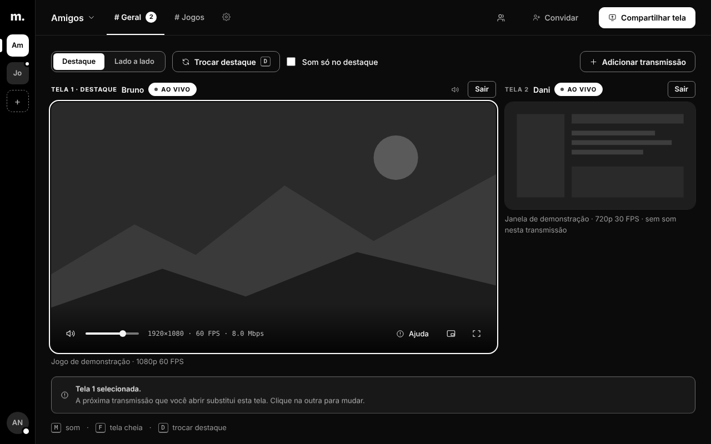

<div align="center">

# madscreen

**Compartilhe a tela e o som de um aplicativo com amigos, com foco em preservar o FPS do jogo.**

[](LICENSE)


[Baixar](https://github.com/vitoradriao/madscreen-releases/releases/latest) ·
[Documentação](docs/README.md) ·
[Contribuir](CONTRIBUTING.md) ·
[Roadmap](docs/roadmap.md)



</div>

> **English summary.** madscreen is an open-source (GPL-3.0-or-later) Windows app for sharing a window or
> monitor — plus that application's audio — with friends in private servers and channels. One install both
> streams and watches (up to two lives at once). Capture uses the official Windows APIs only (no DLL injection or
> game hooks); H.264 is encoded on the GPU (NVIDIA NVENC zero-copy, AMD AMF, Intel QuickSync) with an x264 CPU
> fallback, and delivered over WebRTC through a Cloudflare Realtime SFU, with a self-hosted LiveKit server as a
> backup. The goal is to protect the streamer's game FPS. The project is pre-1.0 and most documentation is in
> Brazilian Portuguese; see [docs/architecture.md](docs/architecture.md) and [docs/building.md](docs/building.md).

## O que é

O madscreen é um aplicativo para Windows que transmite uma **janela ou monitor** e o **áudio do aplicativo
escolhido** para amigos, em **servidores e canais privados** acessados por convite. É o mesmo programa para
transmitir e assistir: dá para abrir **até duas lives ao mesmo tempo**, com volume independente, destaque e tela
cheia. A prioridade do projeto é **preservar o FPS do jogo de quem transmite**.

## Recursos

- **Captura oficial do Windows:** Windows Graphics Capture (janelas e Windows 11) e Desktop Duplication
  (monitor no Windows 10). Sem injeção de DLL, sem *hook* no jogo.
- **Áudio por aplicativo:** WASAPI *process loopback* a 48 kHz estéreo com Opus. Sem microfone. O som do PC exclui
  o próprio app para não recapturar o que você assiste.
- **Encoders H.264 com seleção automática:** NVIDIA NVENC (caminho D3D11 *zero-copy*), AMD AMF, Intel QuickSync e
  fallback por CPU (x264). Não há transcodificação no servidor.
- **Contas e convites:** login com Discord ou Google, contingência por usuário + convite com chave de recuperação,
  servidores, canais, presença e controle de acesso.
- **Duas lives, uma instalação:** prévia da própria live sempre sem som; atalhos **D** (destaque), **M** (som) e
  **F** (tela cheia).
- **Rede:** WebRTC por um SFU da Cloudflare (principal) ou LiveKit auto-hospedado (reserva), com recuperação de
  quadro-chave e adaptação de taxa.
- **Atualização assinada:** o app verifica assinatura e versão e só instala por ação do usuário.
- **Cliente web** que compartilha os mesmos módulos de login, diretório e reprodução do app.

## Estado do projeto

O madscreen está em **desenvolvimento pré-1.0** (a versão publicada é 0.1.x). A interface e o pipeline funcionam
de ponta a ponta, mas **as metas de FPS, latência e sincronia A/V ainda precisam de medições em jogos e hardwares
diferentes** — compilar e passar nos testes não é o mesmo que ter desempenho qualificado. O que está medido, o que
falta e o que está em avaliação está em [docs/roadmap.md](docs/roadmap.md).

## Instalar e usar

1. Baixe o instalador `.exe` na [última release](https://github.com/vitoradriao/madscreen-releases/releases/latest).
2. Abra o convite que recebeu de um amigo e entre com Discord (há contingência por usuário + convite).
3. Escolha um canal. Em **Compartilhar**, selecione janela ou monitor, qualidade e áudio. Para assistir, abra uma
   live do canal; adicione outra para usar duas telas.

Minimizar ou fechar a janela leva o app para a bandeja; use o menu da bandeja para sair ou parar de compartilhar.

**Requisitos:** Windows 10 1903 x64 ou posterior, com WGC e Direct3D 11. Para transmitir, uma GPU NVIDIA, AMD ou
Intel com encoder de hardware (NVIDIA não é obrigatória; há fallback por CPU, de custo maior). O áudio por
aplicativo depende do suporte do Windows ao *process loopback*; sem ele o vídeo continua. O app não pede microfone.

> O app precisa de um **servidor de sinalização** (Cloudflare Worker) para contas, canais e SFU. Quem usa as
> releases oficiais não precisa configurar nada; para rodar o seu próprio, veja
> [docs/self-hosting.md](docs/self-hosting.md).

## Como funciona

```text
App Tauri 2 / WebView2
  ├─ UI compartilhada com o cliente web: login, convites, canais e dois players
  └─ supervisor ──► sidecar madscreen-encode-test --ipc (um processo por transmissão)
                      WGC / Desktop Duplication → D3D11 (escala + BGRA→NV12) → encoder automático
                      WASAPI process loopback → Opus
                                  │
        Worker autenticado (Durable Objects + SQLite) ── Cloudflare Realtime SFU
                                  └──────────────────── LiveKit (reserva)
                                  │
                         WebRTC → player no app ou no navegador
```

Mais detalhes em [docs/architecture.md](docs/architecture.md).

## Compilar a partir do código

Rust estável (edição 2024) com MSVC, Windows SDK, Node 22+ e WebView2.

```powershell
cargo build --release -p madscreen-encode-test --features publish
./tools/encode/prepare-runtime.ps1 -BundleDestination target/release/encoder-runtime
npm ci --prefix viewer
npm ci --prefix apps/madscreen-app
npm run tauri --prefix apps/madscreen-app -- dev
```

O guia completo (variável `VITE_MADSCREEN_URL`, testes, runtime FFmpeg) está em [docs/building.md](docs/building.md).

## Documentação

| Para quê | Onde |
| --- | --- |
| Visão geral e índice | [docs/README.md](docs/README.md) |
| Arquitetura e decisões | [docs/architecture.md](docs/architecture.md) |
| Compilar, testar e depurar | [docs/building.md](docs/building.md) |
| Rodar o seu próprio servidor | [docs/self-hosting.md](docs/self-hosting.md) |
| SFU, LiveKit e *failover* | [docs/sfu.md](docs/sfu.md) |
| Atualizações assinadas | [docs/updater.md](docs/updater.md) |
| Runtime FFmpeg, licenças e patentes | [docs/runtime-distribution.md](docs/runtime-distribution.md) |
| Estado e roadmap | [docs/roadmap.md](docs/roadmap.md) |
| Design system | [docs/design/README.md](docs/design/README.md) |

## Contribuir

Contribuições são bem-vindas: leia [CONTRIBUTING.md](CONTRIBUTING.md). Para reportar uma vulnerabilidade, use o
canal descrito em [SECURITY.md](SECURITY.md) (não abra uma issue pública).

## Licença

[GNU GPL v3 ou posterior](LICENSE). Licenças e avisos de componentes de terceiros em
[THIRD-PARTY-NOTICES.md](THIRD-PARTY-NOTICES.md). A licença de copyright não resolve **patentes de codecs**
(H.264/AVC): o caminho principal usa o encoder do driver da sua GPU. Detalhes em
[docs/runtime-distribution.md](docs/runtime-distribution.md).
